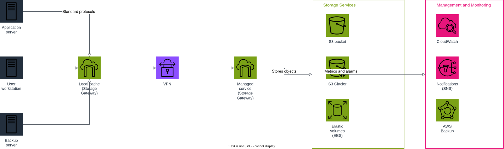

# Hybrid Storage Gateway

A demo of hybrid storage services that provide on-premises access to
virtually unlimited cloud storage, based on the AWS Cloud Quest scenario:
*"Build a set of hybrid storage services that provide on-premises access to
virtually unlimited cloud storage."*

## Architecture



| Component | Purpose |
| --- | --- |
| **On-premises servers** | Application server, user workstation, and backup server accessing storage over standard protocols (NFS/SMB/iSCSI). |
| **Storage Gateway (local cache)** | A `FILE_S3` gateway appliance running on-premises, caching frequently accessed data locally. |
| **VPN** | Site-to-site VPN connecting the on-premises network to the AWS VPC (a dedicated network / Direct Connect could replace it in production). |
| **Storage Gateway (managed service)** | The AWS-side endpoint of the gateway, replicating data to durable cloud storage. |
| **S3 bucket** | Durable object storage backing the gateway, with a lifecycle rule transitioning objects to Glacier after 30 days. |
| **S3 Glacier** | Long-term archival tier for infrequently accessed data. |
| **EBS (elastic volumes)** | Block storage volume used for gateway cache/upload buffer. |
| **EFS** | Shared, elastic file storage mounted from the VPC subnet (`aws_efs_file_system` + mount target). |
| **CloudWatch** | Log group for gateway activity and a metric alarm on `CacheHitPercent`. |
| **SNS** | Publishes email notifications when alarms fire. |
| **AWS Backup** | Daily backup plan covering the S3 bucket and EBS volume, retained in a dedicated backup vault. |

### Flow

1. On-premises application servers, workstations, and backup jobs read/write through the local Storage Gateway cache using standard storage protocols.
2. The local gateway replicates data over a site-to-site VPN to the managed Storage Gateway service in AWS.
3. The managed gateway stores objects durably in S3, which lifecycles older objects into Glacier.
4. EBS volumes and EFS file systems provide additional elastic, cloud-native storage capacity alongside the gateway.
5. CloudWatch tracks gateway metrics (e.g. cache hit percentage) and triggers alarms that notify operators via SNS.
6. AWS Backup takes daily backups of the S3 bucket and EBS volume into a dedicated vault for durability and recovery.

## Usage

This project is validated locally against [floci](https://github.com/) (a
local AWS emulator) rather than a real AWS account.

```bash
# start the local emulator (optional — used for validate-only workflow)
docker compose up -d

# validate the Terraform configuration
terraform init -backend=false
terraform validate
```

## Regenerating the diagram

```bash
python3 -m venv .diagram-venv
.diagram-venv/bin/pip install drawpyo
.diagram-venv/bin/python scripts/generate_diagram.py

# export to SVG/PNG
docker run --rm -v "$PWD/docs:/data" rlespinasse/drawio-export --format svg --output /data /data/architecture.drawio
docker run --rm -v "$PWD/docs:/data" rlespinasse/drawio-export --format png --output /data /data/architecture.drawio
```

## Cleanup

```bash
docker compose down
rm -rf .terraform .build .diagram-venv
```
